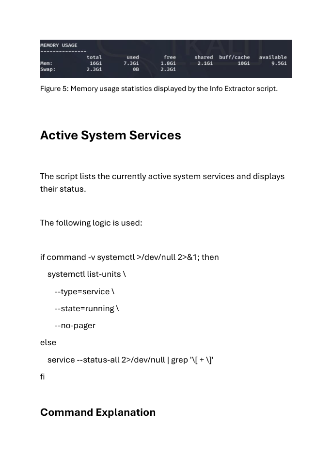

# Linux Info Extractor

A compact Bash script that collects a readable snapshot of a Linux system using standard command-line utilities.

Developed as ThinkCyber coursework by **Javor Mirchev**, with AI-assisted coding and report preparation. Laboratory setup, test execution and screenshots were carried out by the author.

## What it does

- Displays public and private IPv4 information.
- Partially masks the detected MAC address.
- Lists the five busiest CPU processes and memory usage.
- Lists running system services.
- Shows the ten largest accessible files under /home.

## Requirements

Linux, Bash, curl, iproute2, awk, procps, GNU findutils/coreutils and systemctl or service.

The operational workflow was developed for a Linux laboratory. Windows/Git Bash is used only for the offline portfolio checks described below.

## Usage

Start with help, which performs no installation or network/deployment action:

```bash
bash scripts/info-extractor.sh --help
```

Authorized laboratory workflow:

```bash
bash scripts/info-extractor.sh
```

## Evidence and validation



This is a selected historical report excerpt from the author's own laboratory. Historical filenames remain visible. It is not a screenshot of the portfolio revision being re-tested.

- [Laboratory evidence and provenance](docs/EVIDENCE.md)
- [Current offline validation and its limits](docs/VALIDATION.md)
- [Authorship and AI assistance](docs/AUTHORSHIP.md)

Run the local automated checks without an assessment target:

```bash
bash -n scripts/info-extractor.sh
shellcheck scripts/info-extractor.sh
python3 -m unittest discover -s tests -v
```

The included GitHub Actions workflow runs these offline checks after publication. No remote CI result is claimed before it runs.

## Limitations and handling of output

- Normal execution contacts ifconfig.me to determine the public address.
- The /home traversal depends on read permissions and can take time on large home directories.
- The result is a point-in-time snapshot, not continuous monitoring.
- Public addresses, process names and file paths may be sensitive; review output before sharing.

## Portfolio revision

The original coursework script remains unchanged in the author's local source folder. This repository uses a readable script name and includes the following limited changes:

- Added help and argument validation before collecting system information.

The full original reports, raw assessment results, credential files and course assignment briefs are not distributed here. No open-source license is included, by the author's choice.
